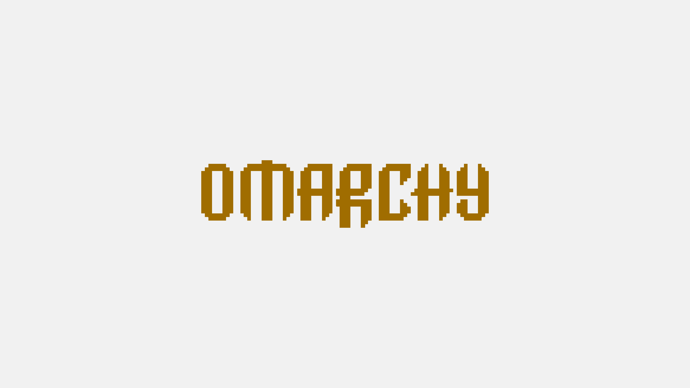

# Melange Light for Omarchy

A light Omarchy theme based on [savq/melange-nvim](https://github.com/savq/melange-nvim), with warm brown text and an ochre accent.



*Wallpaper preview, not a desktop screenshot. Resolution: 3840 × 2160.*

## Palette

| Role | Color |
| --- | --- |
| Background | `#F1F1F1` |
| Warm surface | `#E9E1DB` |
| Deeper surface | `#D9D3CE` |
| Foreground | `#54433A` |
| Accent | `#A06D00` |

Normal and bright colors follow Melange's upstream light palettes, including its stronger bright colors. The wallpaper retains the centered pixel lettering of Omarchy's bundled wallpaper, recolored with this theme's background and accent.

## Install

For recent Omarchy releases using `colors.toml`:

```sh
omarchy theme install https://github.com/xvvhang/omarchy-melange-light-theme
```

Switch later through the theme menu or run:

```sh
omarchy theme set melange-light
```

**Back up an existing theme first:** installation may replace `~/.config/omarchy/themes/melange-light/`.

To preserve your current wallpaper when switching:

```sh
OMARCHY_THEME_SKIP_BACKGROUND=1 omarchy theme set melange-light
```

## Neovim

Omarchy generates application configs from `colors.toml`. The included `neovim.lua` selects the original Melange plugin with a light background; Lazy downloads the plugin on first use.

Recent Omarchy versions ignore Lua files in Git-installed themes for security, so the plugin configuration is not automatically installed. To use it, review `neovim.lua` and merge its plugin specifications into your own LazyVim configuration under `~/.config/nvim/lua/plugins/`, preserving existing customizations.

## Attribution

Palette based on [savq/melange-nvim](https://github.com/savq/melange-nvim). Wallpaper adapted from the Omarchy-bundled Gruvbox `backgrounds/omarchy.png`; no font software is bundled. This is an independent theme, not an official Melange or Omarchy release.

By [Alec Xu / @xvvhang](https://github.com/xvvhang). Companion theme: [Melange Dark](https://github.com/xvvhang/omarchy-melange-dark-theme).
